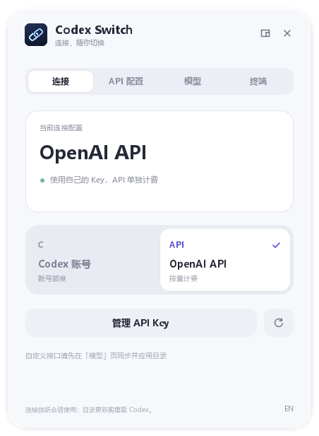

# Codex Switch

English · [简体中文](README.md)

A Windows/macOS app and CLI for switching Codex between an existing account login and an API connection, including official OpenAI, DeepSeek and Responses-compatible New API gateways.

**[Download the installer / portable ZIP](https://github.com/Found-L/codex-switch/releases/latest)**

## Get started

1. Install [Codex](https://learn.chatgpt.com/docs/quickstart). Sign in to Codex first if you want to use account credits.
2. Install `CodexSwitch-VERSION-windows-x64-setup.exe`. Windows 10/11 x64; no Python or administrator access required. On macOS 14+, download the arm64 (Apple Silicon) or x64 (Intel) DMG, drag the app to Applications, then open that copy.
3. Open **Codex Switch**, enter the base URL and its API key, then save. Official OpenAI works with the default catalog. For a gateway, continue to **Models**, discover models, enable coding models, save their capabilities, then apply with the selected model as default.
4. Start a new Codex chat. Use the connection cards to switch back later. The UI includes an English/Chinese toggle.

Keys are kept in Windows Credential Manager or the macOS login Keychain, scoped to your Windows user and Codex configuration directory. Enter your own key again on another computer. Account credits and API usage have separate billing.

On Mac, use **Terminal → Install / repair terminal command**, then open a new terminal. The app runs in the menu bar; shortcuts use Command instead of Ctrl. macOS builds without Developer ID secrets are ad-hoc signed and not Apple-notarized; follow Apple’s first-open instructions in the [macOS guide](docs/macos.md).

## Window and tray

The persistent Qt Quick scene updates state without rebuilding controls, with animated selection and page transitions. The top-right mini button opens a 372 × 302 compact window. Closing or minimizing hides the app to the Windows notification area, which may be under hidden icons. Click its tray icon to toggle the panel; right-click to switch providers, configure a key, or quit.

A tray-opened panel dismisses on focus loss; a desktop-opened window stays visible. Opening the same configuration directory again restores its existing window. In-window shortcuts: `Ctrl+M` hides to tray, `Ctrl+Shift+M` toggles mini mode, and `Ctrl+Q` quits. Switching does not require a chat message.



Screenshots are offscreen renders of the actual QML interface with isolated fixture configuration.

## Gateway models

One New API URL and token can route multiple suppliers by model ID. Search, select multiple coding candidates, choose a default and apply once. Obvious audio/image/embedding models are hidden by default and blocked from generated menus. Unknown aliases remain under All. Draft checkboxes do not write config.

Discovery reads the model list without inference. For the official OpenAI endpoint only, it also attempts an authenticated, client-version-matched Codex catalog lookup, intersecting exact visible API-supported IDs with the public list and preserving official instructions and settings. Gateway keys are never sent to OpenAI. Labels distinguish official metadata from unverified basic templates; neither proves inference access. Manual overrides are under each row's advanced menu and can be reset. Reload Codex after applying; account settings restore when switching back.

```text
codex-switch setup --base-url https://your-gateway/v1
codex-switch models sync
codex-switch models apply --select model-one model-two --default model-one --use
codex-switch models configure your-model-id --context 32768
codex-switch models apply --default your-model-id --use
codex-switch models reset
```

Changing the endpoint requires re-entering its key. Key rotation invalidates the old model list/catalog. Discovery refuses redirects, validates HTTPS certificates and limits responses to 1 MiB. Plain HTTP is allowed only for loopback. Basic templates default to 32K/text-only/no reasoning or speed tiers; these are configuration values, not detected capabilities. Full custom gateway catalog import and inference validation are not included. See the [detailed gateway guide (Chinese)](docs/gateways.md).

## Terminal

Open a new terminal after installation:

```powershell
codex-switch setup --use
codex-switch status
codex-switch use api
codex-switch use account
codex-switch doctor --json
codex-switch gui
```

`setup` hides keyboard input. Do not pass secrets in command arguments or shell history. Automation can use redirected stdin with `setup --key-stdin --use`. Custom homes: `codex-switch --codex-home D:\my-codex status`. The `CODEX_HOME` environment variable is respected.

The portable ZIP needs no installation. Extract it and run `CodexSwitch.exe` or `.\codex-switch.exe`. Do not move its directory after setup: the provider uses an absolute helper path. Re-save API setup after moving it.

## Behavior and limits

Without a custom catalog, switching updates only the top-level provider in global `config.toml`. With a catalog, it also applies the API model and catalog and temporarily replaces reasoning, speed and context settings; account values restore when switching back or removing the API. Setup adds a separately named `codex_switch_api` provider using official [command-backed authentication](https://learn.chatgpt.com/docs/config-file/config-advanced#custom-model-providers). Account login, `auth.json`, MCP and plugins are preserved. Config backups are local to `CODEX_HOME/codex-switch/backups`. Never share backups of a preexisting configuration that may contain other secrets.

Existing official-OpenAI `openai_api` configurations can be reused without migrating credentials. Other providers are not forcibly replaced. A selected profile overriding `model_provider` blocks global switching.

The UI shows global configuration, not the billing route of an already running chat. Existing chats, desktop prewarming/catalog caches, project configs and explicit CLI overrides can differ. Reload Codex if a full menu refresh is needed. The app does not terminate Codex.

Setup is local and does not send requests to verify API access. Availability, modes, quota and key validity depend on the selected gateway and upstream. Discovery reads the published model list; explicit user selections form the custom catalog. Switching itself makes no network/model requests. Requires a Codex build supporting command-backed provider authentication; catalog baseline: `rust-v0.162.1`, tested locally with CLI `0.166.0-alpha.6` model/list. Release targets: Windows 10/11 x64 and macOS 14+ Apple Silicon/Intel. Linux is unsupported.

The per-user installer adds an optional desktop shortcut and user PATH entry. Uninstallation first detaches this tool's managed provider, switches a managed active API config back to `openai`, and removes its keys for registered homes. Account login and local backups remain; external legacy providers are left intact. For portable builds, run `codex-switch remove-api --yes` before deleting files. If permissions/config errors prevent safe cleanup, repair the affected home before uninstalling.

This is an independent community tool, not an OpenAI product. It bundles neither Codex nor API keys. Windows binaries have no commercial code signature. Mac builds without Developer ID credentials are ad-hoc signed and not notarized. SHA-256 checksums are provided.

On Mac, run `codex-switch uninstall --yes` before deleting the app. This removes managed providers/keys, launcher and shell PATH blocks, preserving account login and backups. `uninstall-cli` removes terminal integration only.

## Build

Use Python 3.14 x64 and Inno Setup 6/7:

```powershell
python -m venv .venv
.\.venv\Scripts\python -m pip install -r requirements-build.txt
.\.venv\Scripts\python -m unittest discover -s tests -v
.\scripts\build.ps1 -IsccPath 'C:\Program Files (x86)\Inno Setup 6\ISCC.exe'
```

On macOS, use `.venv/bin/python scripts/macos_ci.py` to build and test with an isolated temporary Keychain. Optional Developer ID/notarization credentials are documented in [the macOS guide](docs/macos.md).

Tagging `v*` runs Windows and both native macOS CI tests/builds and publishes installer, portable ZIP and checksums. See [validation](docs/validation.md), [MIT license](LICENSE), and [third-party notices](THIRD_PARTY_NOTICES.md).
