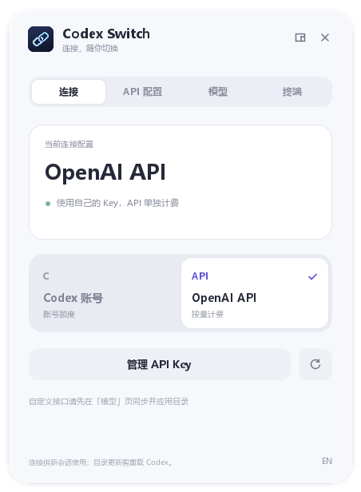
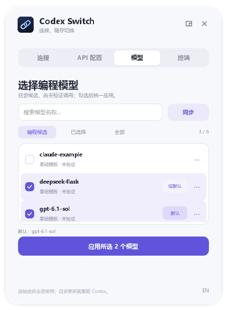

# Codex Switch

[English](README.en.md) · 简体中文

Windows / macOS 上的 Codex 账号 / API 切换工具。支持 OpenAI 官方 API、DeepSeek 和 New API 等兼容 Responses 的接口；可同步模型名单并生成 Codex 菜单目录。保留原有账号登录，无需手工编辑配置文件。

**[下载安装包 / 便携版](https://github.com/Found-L/codex-switch/releases/latest)** · [问题反馈](https://github.com/Found-L/codex-switch/issues)

Fast / Ultrafast 入口消失？0.8.4 在「API 配置 → API 速度」或连接页「Fast / Ultrafast」中提供「启用 Codex 的 Fast / Ultrafast」。点击后完全退出 Codex，Switch 会自动重开并加载内存适配；面板显示等待、加载、失败等实际状态。原生适配保留原有 OpenAI API 提供商，兼容已有 API 会话。普通界面已移除会改变提供商的备用转发按钮。支持 Windows Codex 26.1029.7803.0、26.1103.3517.0、26.1106.6628.0 与直连 OpenAI API；账号速度由 Codex 自己管理。详见 [速度设置与兼容范围](docs/speed-modes.md)。



## 新电脑开始使用

1. 安装 [Codex](https://learn.chatgpt.com/docs/quickstart)。使用账号额度前，先在 Codex 中登录自己的账号。
2. Windows 下载 `windows-x64-setup.exe`；Mac 下载对应芯片的 `macos-arm64.dmg`（M 系列）或 `macos-x64.dmg`（Intel），将 App 拖入 Applications 后打开。支持 Windows 10/11 x64、macOS 14+，无需 Python。
3. 打开 **Codex Switch**，在「API 配置」输入地址与对应 Key。默认是 [OpenAI 官方 API](https://platform.openai.com/api-keys)，保存后即可切换；New API / DeepSeek 则继续在「模型」页同步、启用并应用模型目录。
4. 在 Codex 中新建会话。以后点击连接卡片即可切回账号或 API。

Key 仅保存在这台电脑、当前用户的 Windows 凭据管理器或 macOS 登录钥匙串中。换电脑后重新输入自己的 Key，不需要复制旧电脑的登录文件。账号额度和 API 分开计费。

窗口支持中文 / English，另有终端命令速查。安装器默认创建桌面入口并加入当前用户 PATH；可在安装时取消。已打开的终端需要重新打开后才能使用新 PATH。

Mac 的完整安装、菜单栏、终端命令、卸载与签名说明见 **[macOS 使用指南](docs/macos.md)**。Mac 在「终端」页点击「安装 / 修复终端命令」后，重新打开终端即可使用。当前无 Developer ID 凭据的 Mac 构建为 ad-hoc 签名，未经过 Apple 公证；首次打开需按指南确认系统提示。

## 窗口与托盘

新版使用 Qt Quick 常驻界面：切换只更新状态，选择滑块和页面淡入淡出，不重新创建窗口。右上角小窗按钮可切换到 **372 × 302** 的迷你窗口；关闭按钮或最小化会收进 Windows 通知区域；Mac 收进屏幕顶部菜单栏。托盘图标可能位于任务栏的「显示隐藏的图标」中，可拖到常显区域。

点击托盘图标打开/收起面板，右键可直接切账号/API、配置 Key 或退出。从托盘打开的面板会在点击别处时收起；从桌面打开的窗口保持显示。重复打开同一配置目录会唤回原窗口。

窗口内快捷键：`Ctrl+M` 收进托盘，`Ctrl+Shift+M` 切换迷你窗口，`Ctrl+Q` 退出。Mac 使用相同的 ⌘M、⇧⌘M、⌘Q 快捷键。无需为切换发送聊天消息。


截图由真实 QML 界面在隔离配置下离屏渲染。

## New API / 多供应商模型

只配置一个 New API 地址和 Key，就能同步网关公布的多供应商模型。使用搜索和多选列表，勾选要用的模型、设置默认模型，再一次应用所选。音频、绘图、嵌入等明显非编程模型会过滤并禁止加入；未知别名可在「全部」中查找。首次应用或更新目录后需完全退出并重启 Codex。

同步不执行模型推理。官方 OpenAI API 会尝试匹配同一 Key、当前客户端版本的官方 Codex 目录，保留真实参数与指令，并标记「远端参数 · 未实测」。同时从已安装 Codex 的内置目录补齐精确匹配的模型，标记「Codex 内置参数 · API 未验证」；两者都不是调用权限证明。仍无法匹配的条目标记「基础模板 · 未验证」，不会从名字猜测能力或把网关 Key 发给 OpenAI。手动能力设置移入模型行 `···` 的高级页，普通选择无需盲填参数。切回账号会恢复原账号模型设置。

完整操作、能力限制与撤销说明见 **[网关与模型同步指南](docs/gateways.md)**。



## 配置、目录与会话状态

「连接」显示全局配置，不代表已有会话正在使用该连接。模型页的「状态对照」分别显示全局配置、已保存目录、编辑草稿、现有本机进程检查。模型行标记配置模型和保存项；可把配置模型加入草稿，返回列表保存才写入。切换账号后仍可查看保存的 API 目录。

「草稿所选」与搜索共同过滤，只影响显示。空结果会显示实际勾选数量并提供清除搜索，不表示 Codex 没有该模型。

「只读检查」和 `codex-switch runtime` 仅通过 `codex app-server proxy` 连接现有本机控制入口，读取模型目录与已加载会话数量。不会另开 app-server，不读取聊天内容、不修改会话、不发送推理。如果桌面未开放该入口则显示未知；即使连上本机进程，也不能确认前台选中了哪个会话或真实计费连接。结果带检查时间，不冒充当前桌面实时状态。

## 命令行

```powershell
codex-switch setup --use       # 隐藏输入 Key，保存并切到 API
codex-switch status            # 查看当前配置来源
codex-switch use api           # 切到 API
codex-switch use account       # 切到账号
codex-switch doctor --json     # 本地诊断，不输出 Key
codex-switch gui               # 打开界面
```

Windows 的 PowerShell、CMD、Git Bash，以及 Mac 的 zsh/bash 都可以运行这些命令。Windows 安装后需彻底重开原终端软件以刷新 PATH，只新增标签页可能无效。

支持短命令 `codex-switch api` / `codex-switch account`。不要把 Key 作为命令参数或直接写进命令历史。自动化场景可将秘密通过 stdin 传入 `setup --key-stdin --use`；工具没有 `--key 明文` 参数。

默认使用 `CODEX_HOME`，未设置时为 `~/.codex`。自定义目录放在子命令前：

```powershell
codex-switch --codex-home D:\my-codex status
codex-switch --codex-home D:\my-codex setup --use
```

不同配置目录使用不同的系统凭据条目。便携版解压后直接运行 `CodexSwitch.exe`，或在所在目录使用 `.\codex-switch.exe`。**配置后不要移动便携版目录**；如移动，请重新打开 API 配置并保存，以修复取钥程序路径。希望长期使用终端命令时推荐安装版。

## 配置保留与兼容范围

- 未启用自定义目录时，切换只修改全局 `config.toml` 的顶层 `model_provider`。启用后会同时应用 API 的模型目录与默认模型，暂存账号的模型、目录、速度、推理和上下文配置，切回账号或移除 API 时恢复；MCP、插件和 `auth.json` 不修改。
- 首次配置新增独立的 `model_providers.codex_switch_api` 及命令取钥配置。Key 不写入 TOML、日志或备份；如果原配置本来包含其他明文秘密，原配置备份依然属于敏感文件，请留在本机。
- 每次实际修改前，在 `CODEX_HOME/codex-switch/backups` 保存原配置。无变化的切换不重复改写。
- 可沿用先前已配置、指向 OpenAI 官方 API 的 `openai_api` 提供商，不迁移其 Key，也不覆盖它。未知的其他提供商不会被强行替换。
- 模型同步从指定接口获取名单，再按用户启用项生成本地目录，不把「已列出」当作「已验证」。Key、额度、模型和模式是否实际可用，以网关权限、真实渠道能力和请求结果为准。配置完成不代表已经发送推理请求验证。
- 窗口显示的是**全局配置来源**。已有会话保留原来源；桌面预热会话、模型菜单缓存、项目级配置、CLI `--profile` / `-c` 等覆盖可能影响实际运行来源。必要时重载客户端以刷新菜单。本工具不会重启 Codex。
- 根配置选中的 Profile 如果设置了 `model_provider`，工具会阻止误导性的全局切换，需先处理该覆盖。
- 需要支持官方 [command-backed authentication](https://learn.chatgpt.com/docs/config-file/config-advanced#custom-model-providers) 的 Codex 版本。本机兼容基线为 CLI `0.166.0-alpha.6`；不承诺旧版客户端支持。发行包覆盖 Windows 10/11 x64、macOS 14+ Apple Silicon 与 Intel；不支持 Linux，Windows ARM 未验证。

切换和本地诊断不调用模型、不查询网络；点击「同步模型」才请求指定 API 的模型名单，也不执行推理。工具不附带 Codex 或任何 API Key。它是独立社区工具，与 OpenAI 无隶属关系。

## 卸载

Mac 卸载前先运行 `codex-switch uninstall --yes`，再从菜单栏退出并删除 App；详见 [macOS 使用指南](docs/macos.md#卸载)。

在 Windows 设置中卸载 **Codex Switch**。卸载前会对本工具登记的配置目录移除自建提供商及对应凭据，正在使用自建 API 提供商的全局配置恢复为 `openai`；原 Codex 账号登录和配置备份保留。已有外部 `openai_api` 不由本工具删除。

如目录已迁移、权限变化或配置损坏，安全清理可能阻止卸载；先修复配置或对相应目录运行 `codex-switch --codex-home 目录 remove-api --yes` 后再卸载。便携版删除前也应先运行 `remove-api --yes`，避免保留指向已删除程序的取钥配置。

## 开发与构建

```powershell
python -m venv .venv
.\.venv\Scripts\python -m pip install -r requirements-build.txt
.\.venv\Scripts\python -m unittest discover -s tests -v
.\.venv\Scripts\python app_gui.py
.\scripts\build.ps1 -IsccPath 'C:\Program Files (x86)\Inno Setup 6\ISCC.exe'
```

构建需要 Python 3.14 x64 和 Inno Setup 6/7。`build.ps1 -SkipInstaller` 仅生成便携版。推送 `v*` 标签会在 GitHub Actions 上测试、构建并发布安装包、便携包和 `SHA256SUMS.txt`。当前版本没有购买代码签名证书，可用发布附件中的 SHA-256 检查下载完整性。

macOS 原生构建：`.venv/bin/python scripts/macos_ci.py`，使用临时钥匙串完成构建和安装/卸载验证。可选 Developer ID / 公证 secrets 见 macOS 指南。

测试覆盖格式/编码保留、真实系统凭据读写（隔离测试条目）、失败回滚、并发修改检测、旧提供商兼容和卸载清理；测试不连接真实数据库或发送模型请求。图形界面与打包验收结果见 [验证记录](docs/validation.md)。

## 许可

[MIT](LICENSE)。第三方许可见 [THIRD_PARTY_NOTICES.md](THIRD_PARTY_NOTICES.md)。
